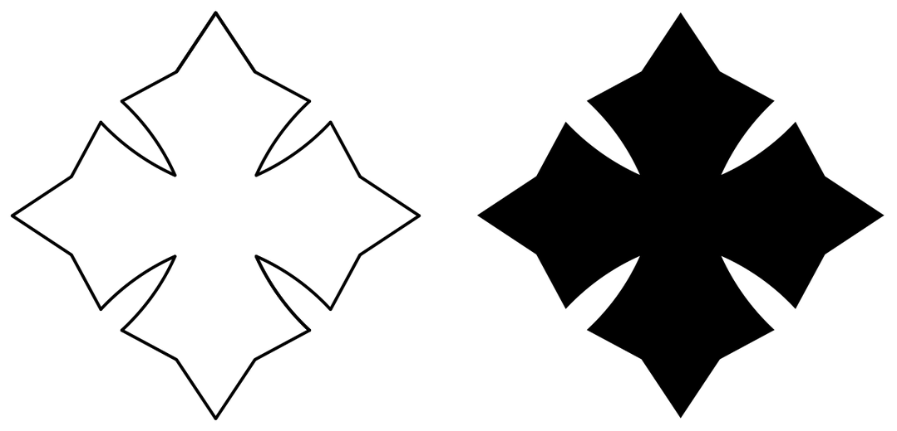

# Cross cliché — outline converted to a solid fill

The source was already vector, so nothing here is re-traced. The geometry that
comes out is the geometry that went in; only the paint changed.



| File | What it is |
| --- | --- |
| `cross.pdf`, `cross.svg` | Solid black, at the source's own size (94.407 × 94.406 mm) |
| `cross-150mm.pdf`, `cross-150mm.svg` | The same, scaled to 150 mm — the source is named `15cm` but measures 94.4 |
| `source-Cliche_15cm.pdf` | The file as supplied |

Rebuild with:

```sh
python3 scripts/outline_to_fill.py \
    assets/cross-cliche/source-Cliche_15cm.pdf assets/cross-cliche --name cross --size-mm 150
```

## What the source is, and what was done to it

28 stroked subpaths, no fill anywhere, drawn with a 2.04 pt pen with round caps
and joins. Two things stopped it being one closed shape, and neither moves the
drawing:

- **Four of the 28 subpaths are exact duplicates** of others, dropped.
- **Consecutive subpaths do not quite share endpoints** — they are out by up to
  0.1105 pt (0.039 mm), invisible under a 2.04 pt pen but enough to stop the
  contour closing. Each join is snapped to the midpoint of the two endpoints
  that meet there, so no point moves by more than 0.0553 pt (0.0195 mm).

The 24 unique subpaths then chain into a single closed contour, closing to
within 0.0001 pt. The fill takes the pen's centreline as its boundary, which is
where the drawing says the edge of the cross is.

## Checked, not assumed

Rasterising both at 600 dpi and measuring the original pen's ink against the new
fill's boundary: the ink sits at a **mean signed distance of −0.0008 mm**, with
its 5th and 95th percentiles at −0.3306 and +0.3306 mm — symmetric either side,
and inside the ±0.3598 mm half-pen. The boundary is on the centreline with no
bias, so the shape is unchanged. Filled area 3725.1 mm².
