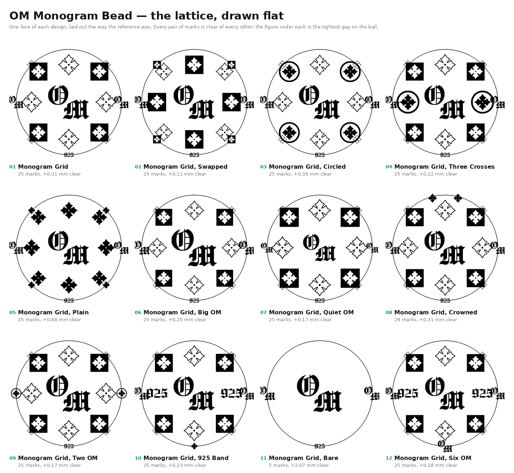

# 8 mm monogram bead



The pattern is a **cube**. A mark at the middle of a face, four on the
cardinals around it, four on the diagonals — on a sphere those are the
cube's 6 face centres, its 12 edge midpoints at 45° and its 8 corners at
35.26°. Twenty-six positions; the hole takes one; the pattern closes on
itself with nothing left over.

That is what the reference drawing turned out to be, and it is why the
earlier compositions could never settle: they were rings chosen by eye.

| | |
| --- | --- |
| `om-bead-8mm-grid.stl` | the reference design, marks raised 0.10 mm; ball 7.80 mm, overall **8.00 mm** |
| `om-bead-8mm-grid-engraved.stl` | the same, marks cut 0.10 mm in; ball **8.00 mm** |

25 marks, four motifs, 1.89 to 3.24 mm across, one closed body of about
326,600 triangles.

```sh
python3 scripts/om_bead.py --list                      # the twelve designs
python3 scripts/om_bead.py --layout "Monogram Grid"    # embossed
python3 scripts/om_bead.py --layout "Monogram Grid" --cut
python3 scripts/om_bead_plan.py --all                  # the flat sheet above
```

**[Turn any of them, and edit them →](https://claude.ai/artifact/1uiDqcXzDRe82fEYbc4pwq)**

## Nothing may overlap, so nothing is left to the eye

`ink_radius()` is how far a motif's ink actually reaches from its
centre. The bounding box answers the same question far more
pessimistically — a cross fills a square with empty corners, so its box
half-diagonal is 1.59 mm where its ink only reaches 1.00 — and on a ball
24.5 mm round that difference is the difference between a pattern that
fits and one that does not.

`gaps()` then reports the edge-to-edge clearance of every pair, smallest
first, and `build()` refuses to write an STL with a negative one. The
twelve designs clear by 0.11 to 0.48 mm; the figure is printed under
each one on the sheet above.

It earned its place immediately. **Every design came out overlapping on
the first run**, all on the same pair: mirroring a ring offset its
southern copy by half a step — right for the medallion it was written
for, wrong for a lattice, because the cube's corners share a longitude
north and south. It put each southern corner directly under an OM at
2.40 mm instead of 3.73. Rings carry a `nest` flag now.

## The hole is blind

Drilled **from one side only**: 1.20 mm wide, 4.00 mm deep, with the
118° point a twist drill leaves under it. The far pole is solid metal
and carries pattern like the rest of the ball.

Its cutter is one revolved profile, not a cylinder unioned with a cone.
Those two meet on a shared plane and the union leaves a sliver of it
behind — a 47-face disc of zero thickness, enough to cost the engraved
beads their watertightness.

## Two things that cost a build each

**A mark at a pole asks for every longitude.** The painter sizes each
mark's box as `dlat / cos(latitude)`. With 925 at the south pole the
guard clamps the cosine to 1e-3, so a 35° box became 35,000° and the
column array killed the process before a pixel was painted. One map
width is the most any mark can need.

**`python ... | tail` reports tail's exit code.** The first of those
three dead builds was logged as a success.

## Why the square stays square

Each mark gets a frame on the sphere — east and north at its own centre
— and the map is carried into that frame by an **azimuthal equidistant**
projection, the one that keeps distance from the centre. Stretching an
equirectangular stamp by 1/cos(latitude) instead bows a 2.4 mm mark into
a trapezoid, because the mark spans about thirty-five degrees and the
cosine changes a long way across it.

## The profile is a laser mark, not a dome

Full depth within 0.05 mm of the edge, flat across the middle, a
slightly eased lip. At 2–3 mm a dome reads as a blister rather than a
mark.

## Still open

Embossed or engraved, and the supplier's **minimum feature size**. At
0.10 mm relief the thin strokes of the OM and the outlined cross are
what is at risk.
