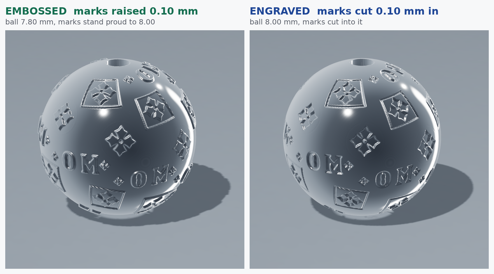

# 8 mm monogram bead

Three marks scattered over a ball, the way a monogram ball carries them:
the **OM lockup**, the **cross in its circle**, and the **cross in its
square**. The plain cross on its own is deliberately not used.



| | |
| --- | --- |
| `om-bead-8mm-embossed.stl` | marks raised 0.10 mm; ball 7.80 mm, overall **8.00 mm** |
| `om-bead-8mm-engraved.stl` | marks cut 0.10 mm in; ball **8.00 mm** |

Both: 1.20 mm bore through the poles, one closed body, ~325,000
triangles. 30 marks, longest side 2.60 mm.

```sh
python3 scripts/om_bead.py                      # embossed
python3 scripts/om_bead.py --cut --out ...      # engraved
```

## Three things a ball makes you get right

**A map is not the ball.** The marks are painted into an
equirectangular map and the ball is displaced through it, so a mark near
the pole covers far more longitude than the same mark at the equator.
Each is stretched by 1 / cos(latitude) as it is painted; without that
they come out pinched top and bottom.

**The map wraps.** A mark crossing the date line has to be painted on
both sides of it. Modular indexing costs nothing and removes the seam.

**Scale by the longer side.** The OM lockup is three and a half times as
wide as it is tall. Sized by height at 2 mm it came out 6.8 mm across —
most of the way round an 8 mm ball — and the first attempt looked like a
collision rather than a pattern.

The marks are placed on a golden spiral, which only spreads evenly if z
steps uniformly over the *whole* sphere: the band away from the poles is
taken out of a full spiral rather than the spiral being squeezed into
the band. The poles are left clear for the bore.

## The profile is a laser mark, not a dome

The relief goes to full depth within 0.05 mm of the edge and stays flat
across the middle — crisp wall, flat floor, a slightly eased lip. The
domed profile used on the flat PA & CO part is wrong here; at 2.6 mm a
dome reads as a blister rather than a mark.

The square element arrives on the tile in reverse, as a filled square
with the cross knocked out of it. Used as supplied the square is the
mark and the cross is the gap, so it is inverted and the square drawn
back round it as a rule — which is what it is on the tile.
