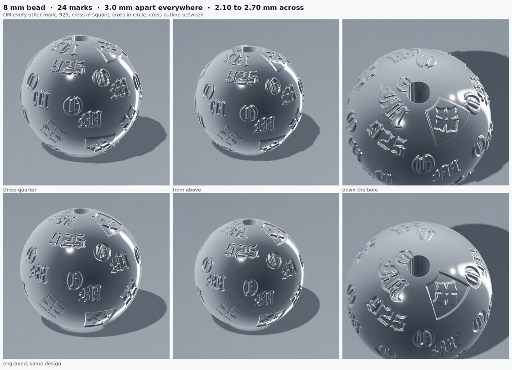

# 8 mm monogram bead

The five marks from **page 101 of the tshirt design** — **OM**, the
**cross in a filled square**, **925**, the **cross in a circle** and the
**cross outline** — laid over a ball at one spacing.



| | |
| --- | --- |
| `om-bead-8mm-pattern.stl` | marks raised 0.10 mm; ball 7.80 mm, overall **8.00 mm** |
| `om-bead-8mm-pattern-engraved.stl` | marks cut 0.10 mm in; ball **8.00 mm** |

24 marks, **3.0 mm apart everywhere**, 2.10 to 2.70 mm across, 1.20 mm
bore through the poles, one closed body, ~325,000 triangles.

```sh
python3 scripts/om_bead.py --marks 24              # embossed
python3 scripts/om_bead.py --marks 24 --cut        # engraved
```

## Three goes at the spacing, and what each one taught

**A golden spiral.** Even density, which is not the same thing as even
spacing to look at, and with no order to the marks it read as a scatter.

**A grid of rows.** Rows a fixed arc apart hold a whole number of marks,
so every row's spacing rounds to a different value — and above the last
row there is nothing at all, which is the bald cap around the bore.
Neither fault can be fixed by picking better numbers. A sphere has no
regular tiling of that kind.

**Back to the spiral, with the order in the marks instead.** A Fibonacci
spiral does have the one property that matters here: every point is the
same distance from its neighbours, at the poles as much as the equator.
That is what "the spacing is always the same" means on a ball, and it
leaves no gap to go bald. Points are generated over the whole sphere and
then the caps dropped, so what remains keeps the spacing of the whole.

The order comes from the marks: they cycle in a fixed sequence and all
stand upright, so the eye reads a pattern rather than a scatter.

## Two things that are not obvious

**The sequence length matters more than it looks.** On a Fibonacci
spiral, points that are neighbours *in space* are a Fibonacci number
apart *in index* — 5 or 8 or 13 for a couple of dozen marks. A sequence
eight long therefore handed every spatial neighbour the same mark and
the ball came out in bands of one kind. Nine shares no factor with 5, 8
or 13.

**The marks are not at the page's relative sizes.** There the little
crosses are a third of the OM, which on an 8 mm ball puts them under a
millimetre and leaves gaps that read as bald. They are sized to look
equal instead, so the space between any two marks is the same wherever
you look. The OM takes every other place — it is the mark, the rest are
its accents.

## Three things a ball makes you get right

**A map is not the ball.** The marks are painted into an
equirectangular map and the ball is displaced through it, so a mark near
the pole covers far more longitude than the same mark at the equator.
Each is stretched by 1 / cos(latitude) as it is painted; without that
they come out pinched top and bottom.

**The map wraps.** A mark crossing the date line has to be painted on
both sides of it. Modular indexing costs nothing and removes the seam.

**Scale by the longer side.** The OM lockup is three and a half times as
wide as it is tall. Sized by height at 2 mm it came out 6.8 mm across —
most of the way round an 8 mm ball — and the first attempt looked like a
collision rather than a pattern.

**A monogram ball is a lattice, not a scatter.** The first attempt
placed the marks on a golden spiral, which gives an even *density* and
reads as random.

**And the unit is the cell, not the mark.** The pattern is not five
motifs taking turns; it is one block of five that repeats, and the block
has to stay together or it stops reading as a pattern. So whole cells
are placed: rows a cell-height apart, each row holding as many whole
cells as its own circumference takes, and the five marks dropped in at
the fractions they occupy on the page. The step in latitude is an arc,
cell height over radius; the step in longitude is cell width over
radius, divided by cos(latitude). The poles are left clear for the
bore.

The one liberty taken is `--mark`: the page proportions are thin for a
ball this small, so the marks are scaled up inside their cell while the
cell keeps the page's geometry.

## The profile is a laser mark, not a dome

The relief goes to full depth within 0.05 mm of the edge and stays flat
across the middle — crisp wall, flat floor, a slightly eased lip. The
domed profile used on the flat PA & CO part is wrong here; at 2.6 mm a
dome reads as a blister rather than a mark.

The square element arrives on the tile in reverse, as a filled square
with the cross knocked out of it. Used as supplied the square is the
mark and the cross is the gap, so it is inverted and the square drawn
back round it as a rule — which is what it is on the tile.
