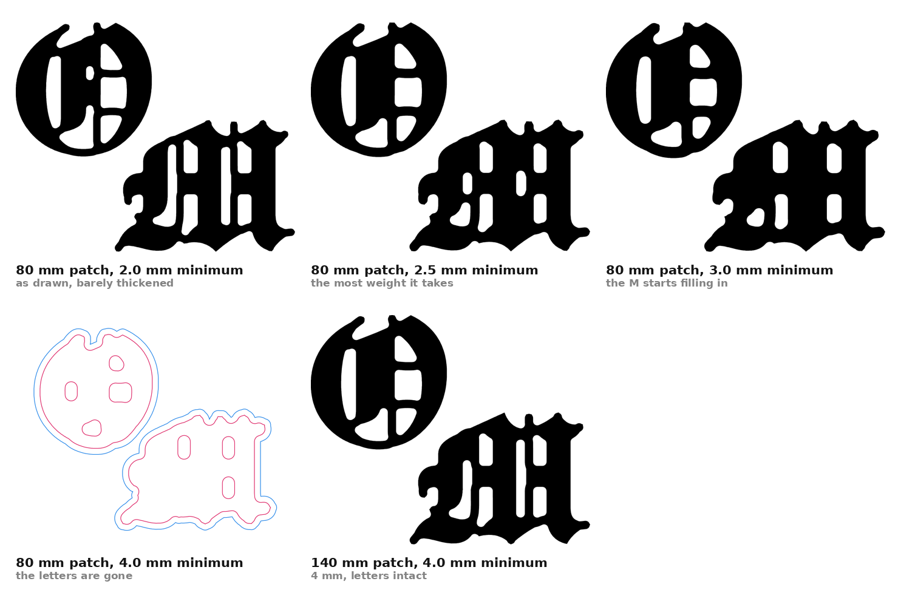

# OM leather cutting die

Two layers, two letters. **TOP** is the mark, cut as the O and the M.
**UNDER** is the backing, one piece per letter, offset outward. Nothing
joins the O to the M on either layer.

| | |
| --- | --- |
| `om-die-both.dxf` | R12 DXF, layers TOP and UNDER — the production file |
| `om-die-drawing.pdf` | A3, dimensioned, for the die maker |
| `om-die-both.pdf` / `.svg` | both layers |
| `om-die-top.pdf`, `om-die-under.pdf` | one layer each |

## This set: 80 mm finished

| | |
| --- | --- |
| Finished patch | **80.00 × 66.32 mm** |
| Letters | 76.00 × 62.32 mm |
| Backing | +2.00 mm all round |
| Smallest feature | **2.52 mm** |
| Gap, O to M | 6.18 mm |
| Backing to backing | 2.18 mm |

```sh
python3 scripts/om_die.py --overall 80 --min 2.5 --offset 2.0 --fatten --separate
```

## Why 2.52 mm and not 4 mm



A 4 mm minimum on an 80 mm patch is not a die problem, it is a
letterform problem. The blackletter's counters — the white shapes that
make an O an O — are themselves under 4 mm at that size, so closing the
outline at 4 mm swallows them. The mark comes out as two blobs with
holes in them.

The limit is **relative, not absolute**: this mark holds a minimum of
about 3% of its own width. Past that the M fills in first.

| Finished patch | Minimum it holds | Counters left |
| --- | --- | --- |
| 80 mm | 2.0 mm | 12 |
| 80 mm | **2.5 mm** | 12 |
| 80 mm | 3.0 mm | 10, M filling in |
| 80 mm | 4.0 mm | letters gone |
| 140 mm | **4.0 mm** | 11 |

`../om-die-4mm/` holds the 4 mm minimum at the size it needs: a 140 mm
patch, letters 136 mm, backings 7.05 mm apart.

## How the thickening works

Only what is under the minimum is thickened, along the medial axis. A
uniform swell reaches the same figure and costs far more: at 80 mm it
closed the gap between the O and the M from 6.50 mm to 3.88 mm and took
the counters from ten down to two. The letterform survives being
thickened where it is thin. It does not survive being thickened
everywhere.

Before that, the outline is closed at the minimum, which fills notches a
steel rule cannot be bent into and takes nothing off the letterforms.
Counters too small to cut are dropped; those that remain are cut
through.

## Two things worth keeping

**The backings are offset per letter and never unioned.** Offsetting the
pair together welds them the moment the offset passes half the gap —
which at 80 mm is 3.09 mm, inside the range anyone would reach for. The
script refuses an offset that would overlap and says what the limit is.

**Dilation is a distance transform, not a structuring element.** At a
4 mm minimum and 60 px/mm the disc is 241 × 241 over a 19-megapixel
image, which runs the machine out of memory. The distance transform is
linear.
