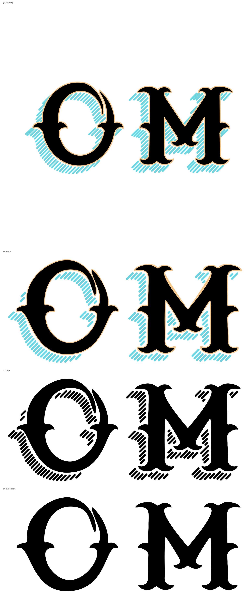

# OM — the hand-drawn mark, redrawn clean

Your iPad drawing is the design. This is that design drawn properly.



| File | What it is |
| --- | --- |
| `om-colour.pdf` / `.svg` | Full artwork — cyan hatch, cream keyline, black letters |
| `om-black.pdf` / `.svg` | One-colour: letters **and halo**, all black |
| `om-black-letters.pdf` / `.svg` | Letters only — for stamping or engraving small |
| `source-drawing.jpg` | The drawing as supplied |

```sh
python3 scripts/om_clean.py assets/om-hand/source-drawing.jpg assets/om-hand
```

Colours sampled from the drawing: cyan `#6cd7e1`, cream `#f4c88b`.

## Why this is not a trace

Earlier versions traced the drawing as exactly as possible and were checked by
how closely they matched it. That was the wrong target, and it guaranteed the
faults: a pen edge wobbles, a hatch stroke stops wherever the hand lifted, and
the keyline strays over an outline and takes a bite out of it. Reproducing all
of that accurately still produces a rough sketch. Every defect marked on those
versions was a faithfully reproduced feature of the drawing.

So nothing here is traced for its own sake. The drawing is **measured**, and the
measurements are drawn clean.

### The letters

The outline is rebuilt on structural nodes only — corners, and the extremes in x
and y — with **one cubic per span**, which cannot dent in the middle because it
has no interior control of its own. That took the two letters from 299 traced
segments to **108 nodes**, which is a type-design node count rather than a
tracing one.

The M is drawn as one half and reflected. Symmetrising the *mask* is not enough:
rebuilding on structural nodes does not place those nodes symmetrically even when
the shape is, so the M was symmetrical as pixels and not as curves. Drawing one
half and mirroring it took the M from **self-IoU 0.9719 to 0.9992**. The seam
nodes — the top notch and the centre vertex — are snapped onto the axis, where
they belong.

The O is left unmirrored: its flourish is one-sided by design.

Neither letter's counter is an enclosed hole. The O's opens through the channel
beside its flourish and the M's open at the bottom, so the two letters are two
closed contours and no more.

### The halo

Measured off the drawing's 136 strokes:

| | drawing | drawn clean |
| --- | --- | --- |
| angle | 135.0° ± 2.65° | **135.00° ± 0.016°** |
| width | 14.3–15.7 px (two methods) | **15.0 px ± 1.4%** |
| pitch | 21.4 px between neighbours, 22.6 px by scan | **22.0 px** |
| white gap | 5.7–7.1 px | **7.0 px** |

The angle and the width are plainly meant to be constant, so they are made
constant. At exactly 135° the strokes are the anti-diagonals `x + y = c`, so the
hatch is generated as one true parallel family — even pitch everywhere, no
accumulated drift — and clipped to the band the drawing's own strokes imply.
Each stroke is a real stadium: a rectangle closed by two semicircular caps built
from quarter-circle cubics.

Length is **not** regularised: it varies 1.4× across the deciles because the halo
is deeper in some places than others, and that is the shape of the thing.

Three details that matter:

- **The band is not eroded in all directions.** Doing that eats the places where
  the halo is only one stroke deep — the O's upper left — and shortens every
  stroke besides. A stroke only has to clear the letters along its own length,
  and end just inside the halo's outer edge, which is a trim of one radius at
  that end alone.
- **The letters are cleared by construction**, not patched afterwards: the band
  has the letters-plus-gap dilated out of it before any stroke is cut, so a
  stroke cannot touch a letter. Measured clearance in the finished file: 24 px
  minimum at 400 dpi.
- **Orphans are dropped.** A stroke with no neighbour within 2.2 pitches is a
  speck the band tapered down to, not part of the hatch, which reads as a run.
  Five went.

### The keyline

An even ring: the letters grown by the 6 px the drawing's cream measures, traced
and rebuilt the same way, painted under the letters so only the ring shows. In
the one-colour version it is dropped and the hatch's constant 9 px standoff does
its job, so there is no hand-drawn white channel to go ragged.

## Checked

At 400 dpi, with the mark 6926 px wide:

- hatch angle **135.00° ± 0.016°**, width **54.6 px ± 0.79** (± 1.4%)
- 117 strokes, none closer than **24 px** to a letter
- M mirror self-IoU **0.9992**
- two letter contours, 108 nodes
