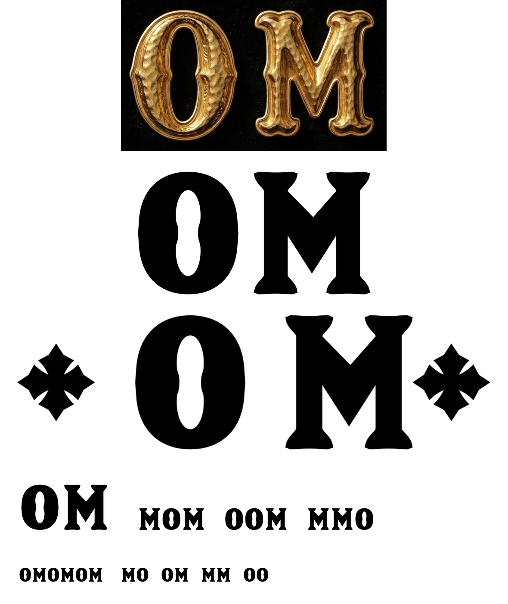
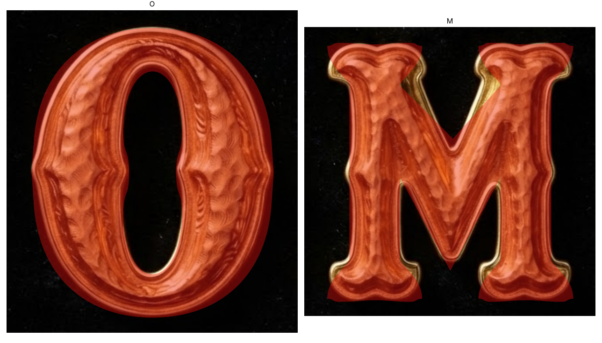

# OM — the pair, constructed

O and M as a pair, in a face built to carry the gold reference's character.
Nothing here is traced: every outline is straight lines, circular arcs and
splines whose tangents were chosen, so the curves are smooth because of how they
are defined rather than how hard they were filtered.



| File | What it is |
| --- | --- |
| `OberndorferOM-Regular.otf` | The font — installs, maps to O and M, sets and spaces |
| `OberndorferOM-Regular.woff2` | The same for the web, under 1 kB |
| `om-om.pdf` / `.svg` | The pair |
| `om-o.*`, `om-m.*` | Each letter on its own |
| `om-lockup-3mm/4mm/5mm.*` | Cross, O, M, cross — for the ring, at three sizes |
| `specimen.pdf` | Set in the font itself |

```sh
python3 scripts/om_mark.py assets/om-mark --cap-mm 3 --cap-mm 4 --cap-mm 5
```

## Why this was started over

Every earlier version derived the letters from the photograph and then tried to
clean up what the scan left behind — trace, smooth, trim, refit, symmetrise. That
cannot work, and the repeated dents were the proof. A dent in a casting is a
**low-frequency** deviation: smoothing follows it and curve fitting reproduces
it. Stacking more passes made each version slightly cleaner and still wrong,
because the method carried the scan's noise floor through to the output.

There is no sampled data in this pipeline at all. Dents are not filtered out —
they are impossible.

## Western, not Didone

The decisive note, and the one it took far too long to hear: the gold letters,
the 1936 "PREMIUM" lettering and the cross are all **one vocabulary — western /
French Clarendon wood type**. Earlier drafts here were a Didone-ish slab, which
is a different century and a different attitude, and no amount of tuning a slab
makes it western.

What actually separates them, read off the reference:

- A western serif **does not meet the stem in a fillet.** It flares into it on a
  long concave **cove**, and the serif is huge.
- The serif's tip turns up into a **spur**.
- The serif's edge is **waved** - it rides over a hump, dips in the middle and
  rises again, rather than running flat.

## What gives the letters their character

A plain Didone O and a plain slab M come out clean but generic, which was the
first mistake after the reset. The reference's interest lives in specific
features, so they are drawn deliberately:

- **The O's faceted flanks.** Each side runs dead straight for a stretch and
  meets its opposite number in a shallow vertex — a real straight line between
  two tangent points, not a curve that happens to flatten.
- **The O's waisted counter.** It pinches at half height. Built as a pair of
  vertical-tangent nodes with an S between them.
- **The M's spurred, waved, coved serifs** — see above. This is the single
  biggest thing separating the mark from a generic slab.
- **The M's thick-left, thin-right V**, from putting the inner apex right of
  centre.

## Measured, then verified by overlay

The failure that ran through every earlier attempt was not the method, it was
the **magnitudes**. A real feature would get spotted and then drawn at three to
five times its actual size, so each one was individually "correct" and the whole
letter was a caricature. The numbers, measured off the photograph:

| | reference | an earlier draft |
| --- | --- | --- |
| M stem waist | 6% narrowing | ~30% |
| M serif thickness | 0.120 cap | 0.160 cap |
| O flank facet | 2% off an ellipse | a visible corner |
| O counter width | 0.203 cap | 0.316 cap |

Three structural facts about the M had also been drawn wrong, and only showed up
once they were measured rather than eyeballed:

- **The V's apex floats above the baseline**, at about 0.17 cap. It does not
  touch down.
- **The top notch bottoms out at 0.63 cap**, much higher than it looks.
- **The V merges into the stems at 0.48 cap**, so the counters are small
  triangles rather than tall wedges.

Everything is now checked by drawing the glyph over the photograph at matched cap
height (`overlay-check.png`) rather than by describing it. That is the only test
that has caught anything.



## Deliberately not copied

Contrast is **lower** than the gold reference's. At three millimetres the thin
part of a high-contrast letter is the first thing to disappear, and this mark
has to survive being struck into metal. Fidelity to the photograph would be the
wrong call here.
