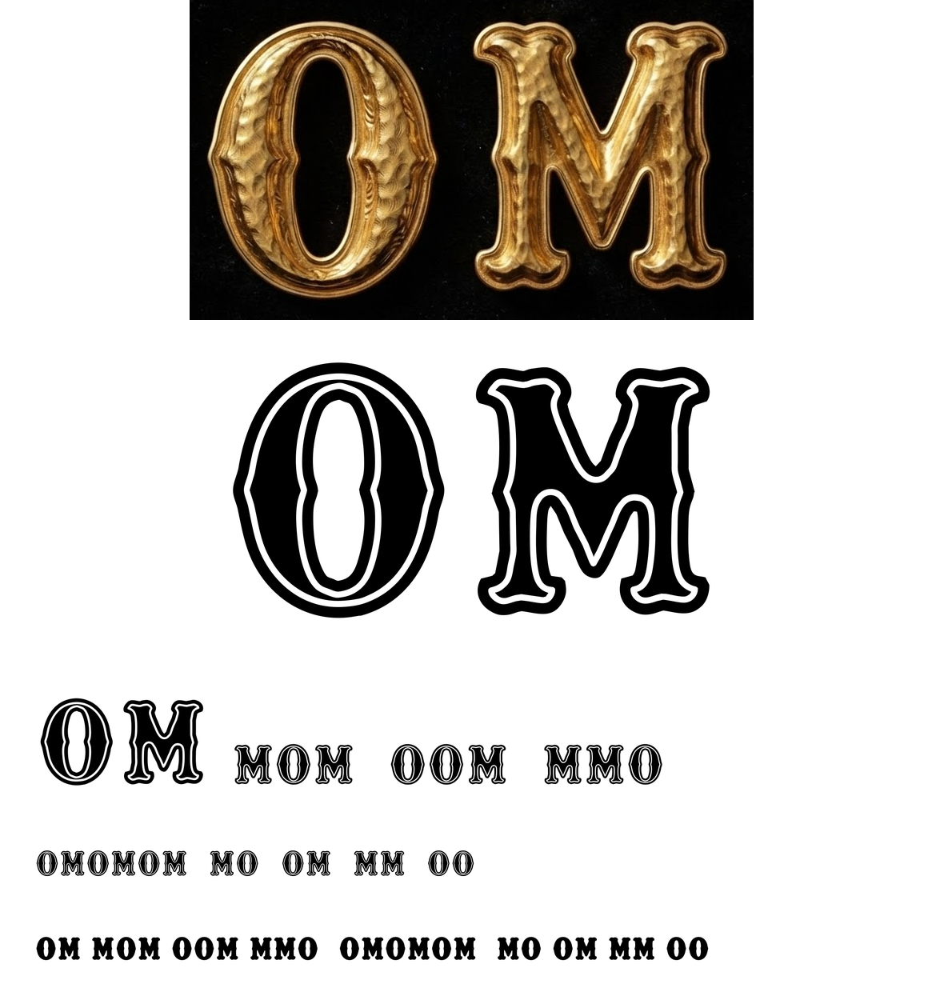

# OM — a font from the cast gold letters

Two capitals traced from the photograph of the gold O and M on black velvet,
built into a working font and vector artwork.



Two styles: **Inline**, which carries the groove the metal is cast with, and
**Regular**, the plain silhouette.

| File | What it is |
| --- | --- |
| `OberndorferOM-Inline.otf` | The font with the groove — installs, maps to O and M, sets and spaces |
| `OberndorferOM-Regular.otf` | The same letters, solid |
| `*-Inline.woff2`, `*-Regular.woff2` | Same outlines for the web, 1–3 kB, for `@font-face` |
| `om-o-inline.pdf`, `om-m-inline.pdf`, `om-om-inline.pdf` | Vector artwork, 480 pt cap height |
| `om-o.pdf`, `om-m.pdf`, `om-om.pdf` | The solid versions |
| `om-*.svg` | All of the above as SVG |
| `specimen.pdf` | A specimen set in both styles |
| `reference-gold-om.jpg` | The source photograph |

Rebuild with:

```sh
python3 scripts/metal_letters_font.py \
    assets/om-metal-letters/reference-gold-om.jpg assets/om-metal-letters --size 480
```

## How the letters were lifted off the photograph

A luminance threshold does not work here: the letters' own shadowed sides are as
dark as the velvet, so it cuts them off. The velvet is **neutral**, though, and
cast gold is not — thresholding **chroma** (max minus min of RGB) gives exactly
two components, with no holes and no spill, and is stable anywhere between 18
and 40. The outline is then taken from the chroma image's own anti-aliased edge
rather than from the binary mask, so edge positions are sub-pixel; interior and
exterior are forced solid three pixels either side of the boundary so the
hammered texture inside the metal cannot raise a contour of its own.

## What was smoothed, and what was kept

These letters are cast and hammered, so the silhouette carries roughly two
pixels of physical irregularity at this resolution. A font wants deliberate
curves, so the fit tolerances are set to absorb that wobble rather than trace
it — the M comes out as 23 straight segments and 75 curves, the O as 2 and 35.

The corner-preserving fit keeps what is real. In particular the **O is not an
oval**: each flank has a genuine angular vertex, which is clearly there in the
casting, and the trace keeps it.

The **O is symmetrised** about both axes. It is drawn with a vertical stress and
measures symmetric to within 1–2 px in the photograph, so the residual is camera,
not design — the mirror residual is 0.011 px mean on the vertical axis and 0.019
on the horizontal. The **M is left alone**: its V is deliberately thick on the
left stroke and thin on the right, and mirroring it would destroy that.

## The inline

The castings are bevelled, and the bevel leaves a groove running parallel to the
whole outline — counters included. Measuring it rather than guessing: take the
luminance inside each letter, divide out the lighting gradient with a heavily
blurred copy of itself, and plot the result against distance from the outline.
The profile is unambiguous — a bright peak at 3–4 px (the raised rim catching
the light), then a trough bottoming out at 17–20 px (the groove), then back to
field level by 26 px.

So the groove is cut at **18 px inset, 8 px wide** — 39 and 18 units at a cap
height of 700. It is a constant offset because the casting's is: the groove is a
moulded chamfer, not a drawn line, which is why it holds its distance around
every bracket and serif.

The inline nests four contours deep — outline, groove outside, groove inside,
counter — so contour direction has to alternate with nesting depth rather than
simply "biggest one is the outer". Getting that wrong fills the counters in.

## Font metrics

| | |
| --- | --- |
| Units per em | 1000 |
| Cap height | 700 (set by the M's flat top and foot) |
| O | 691 units wide, overshooting the cap band by 11 units top and bottom |
| M | 753 units wide |
| Sidebearings | 45 units a side — half the letter gap in the photograph |
| Space | 300 units |

The O's overshoot is what it was cast with, centred on the same cap band as the
M rather than copied from where the letter happened to lie on the velvet.

The family name is a default. Pass `--family "Your Name"` to change it; the
PostScript name, full name and unique identifier all follow from it.

`--inset` and `--groove` move the inline, in source pixels. `--sigma`,
`--line-tol` and `--curve-tol` set how much of the casting's irregularity the
outline keeps — lower them for a trace that follows the metal more literally,
at the cost of a wobblier letter.
