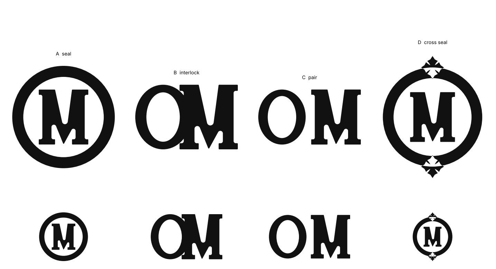
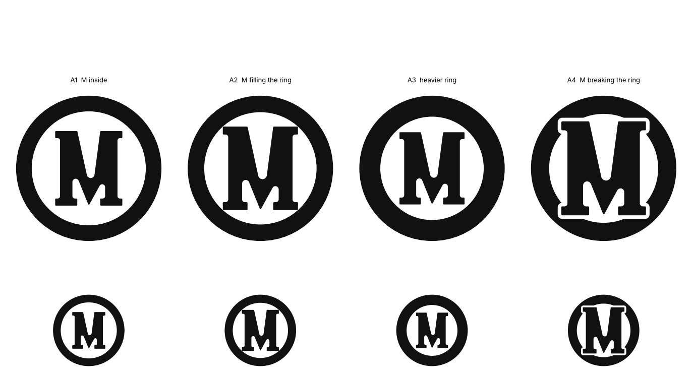

# OM monogram — constructed, not traced

Everything in this folder is built from geometry. No coordinate comes from the
photograph; the reference informs proportion only.

## Why the earlier attempts kept failing

Every previous pass derived the letters from the photograph and then tried to
clean up what the scan left behind — trace, smooth, trim, refit, symmetrise.
That cannot work. A dent in a casting is a **low-frequency** deviation: smoothing
follows it, and curve fitting reproduces it. Each pass got a little cleaner and
was still wrong, because the method carried the scan's noise floor into the
output no matter how many filters were stacked on it.

`scripts/monogram.py` starts over. Outlines are straight lines and circular arcs
joined at exact tangents, and every corner is cut by an analytic fillet. Dents
are not filtered out — they are impossible, because there is no sampled data in
the pipeline at all.

- **O** — two ellipses. Contrast is deliberately *lower* than the gold
  reference's: at three millimetres the thin part of a high-contrast O is the
  first thing to disappear.
- **M** — an explicit vertex list: two upright stems, square slab serifs, and a V
  whose outer edges meet in a point on the baseline. The inner apex sits right of
  centre, which keeps the left stroke heavier than the right, as the reference is
  drawn — moderated, because a very thin stroke will not survive being struck.

## The brief this is answering

A mark for a ring: a few millimetres across, struck or engraved in metal, and it
has to read before the letters do. That argues for fewer and larger shapes, a
bolder cut, lower contrast, and a silhouette with its own identity — which is why
the four directions are monograms rather than two letters side by side.
