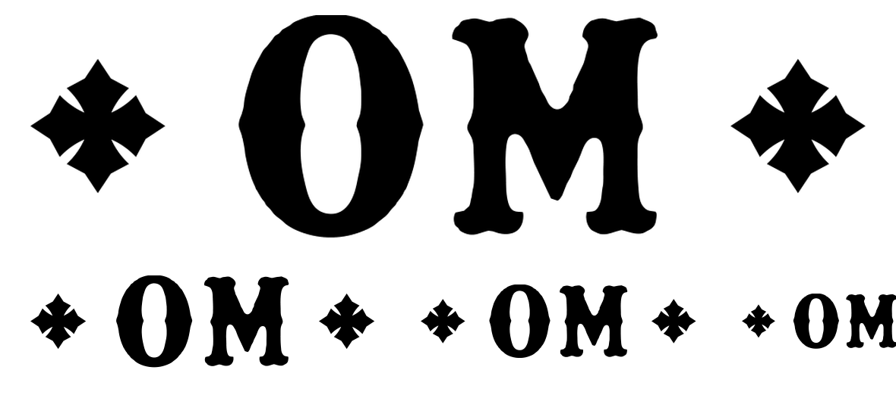

# OM ring mark — ✠ OM ✠

The lockup for stamping or engraving on a chain link: the two capitals traced
from the gold letters, flanked by the cross from the cliché.



| File | Mark height | Overall |
| --- | --- | --- |
| `om-lockup-3mm.pdf` / `.svg` | 3 mm cap | 11.511 × 3.074 mm |
| `om-lockup-4mm.pdf` / `.svg` | 4 mm cap | 15.349 × 4.099 mm |
| `om-lockup-5mm.pdf` / `.svg` | 5 mm cap | 19.186 × 5.124 mm |

Everything is **flat black and a single set of filled paths** — no strokes, no
gradients, nothing a laser or a steel stamp cannot hold. Sizes are quoted as the
cap height of the letters, because that is what has to fit the band.

Rebuild, at any sizes:

```sh
python3 scripts/om_lockup.py \
    assets/om-metal-letters/reference-gold-om.jpg \
    assets/cross-cliche/source-Cliche_15cm.pdf \
    assets/om-ring-mark --cap-mm 3 --cap-mm 4 --cap-mm 5
```

`--cross-ratio` (default 0.62) sets the cross height against the cap, `--gap`
(default 0.34) the space either side of the letters.

## What survives at this size

Measured off the artwork — narrowest black feature and tightest white gap, as a
fraction of the mark height and then in millimetres:

| | of cap | 3 mm | 4 mm | 5 mm |
| --- | --- | --- | --- | --- |
| **O** black | 0.0886 | 0.266 | 0.354 | 0.443 |
| **O** gap | 0.0836 | 0.251 | 0.334 | 0.418 |
| **M** black | 0.0464 | 0.139 | 0.186 | 0.232 |
| **M** gap | 0.0803 | 0.241 | 0.321 | 0.401 |

Laser engraving generally holds about 0.10 mm; a steel stamp about 0.15–0.20 mm.

So:

- **At 4 mm and up, everything clears both processes.** The M's thinnest stroke
  — the top of its thin right diagonal — is the limiting feature at 0.186 mm.
- **At 3 mm that stroke falls to 0.139 mm**, which is fine for a laser but under
  what a steel stamp reliably holds. If it has to be stamped at 3 mm, the M wants
  that one stroke thickened; say the word and I'll do a stamp-specific cut.
- **The cross tapers to true points.** Those will round over slightly at any of
  these sizes whatever the process — normal, and usually reads fine, but it is
  the first thing that will soften.

## A note on weight

These letters are drawn at the weight the gold *reads*, not the weight of its
silhouette — see `../om-metal-letters/README.md`. That matters more here than it
does in print: stamping and engraving both spread, so starting from the heavier
silhouette would close the O's counter and the M's notches up at ring scale.
