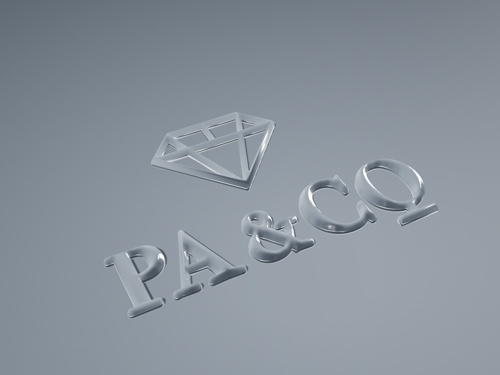

# PA & CO logo — satin silver

`paco-logo.stl` photographed in a studio. 50.00 × 34.83 × 1.80 mm, six
pieces, 456.3 mm³.



| | |
| --- | --- |
| `paco-satin-hero.png` | three-quarter, the set-up shot |
| `paco-satin-plan.png` | near plan — the lockup as it reads |
| `paco-satin-three-quarter.png` | lower three-quarter |
| `paco-satin-raking.png` | across the light, for the 1.80 mm profile |
| `paco-satin-detail.png` | the ampersand, close |
| `paco-satin-diamond.png` | the diamond, close |
| `paco-satin-hero-light.png` | the same shot in the pale room |

Rebuild with:

```sh
python3 scripts/studio/smooth_normals.py paco-logo.stl logo.bin
node scripts/studio/render.js dark grey      # or: light light
```

## Two things the file needed before it could be lit

**The dome is a staircase.** The STL was built by unioning level sets: 38
z levels, 42,617 horizontal faces, 44,747 vertical, and not one sloped
triangle. Shaded off its own face normals it reads as a contour map,
every 0.08 mm tread catching the light flat. `smooth_normals.py` leaves
the geometry alone and rebuilds only the normals, and only above the
0.30 mm base, by rasterising the dome as a height field, blurring it
(normalised by its own mask, so the six pieces do not bleed into each
other) and reading the gradient back. The part keeps its sharp edges and
the dome shades as the surface it stands for. A polished part would lose
those treads anyway.

The first version of that fitted a plane to each vertex's neighbours
inside a 0.35 mm ball. On treads that fine it is twenty million pairs,
and it was still running after four minutes.

**Satin is not a roughness number.** The look comes from grooves that run
one way, so the highlight stretches along the brush and stays tight
across it. Two procedural maps do it: roughness varying lane by lane
between 0.11 and 0.40, and a normal map whose slope is almost all across
the lanes (normalScale 0.95 across, 0.07 along). UVs are a planar
projection down z, so the brush runs straight across the whole lockup.

## On the room

Silver has no colour of its own — it is the room, reflected. The first
dark set-up produced a black part, not a dark silver one, so the second
room is mid grey rather than near-black, with four softboxes doing the
work: a wide key overhead left, a long strip to the right read *across*
the brush, a front fill and a kicker behind.

The sky was a ShaderMaterial to begin with. PMREMGenerator renders the
environment scene itself, and whatever it does to a custom shader on the
way into the cube target comes back as a map that drives every lit
surface to black — the metal, the ground, the lot. A gradient painted on
a canvas gives the same sky and survives the trip.
