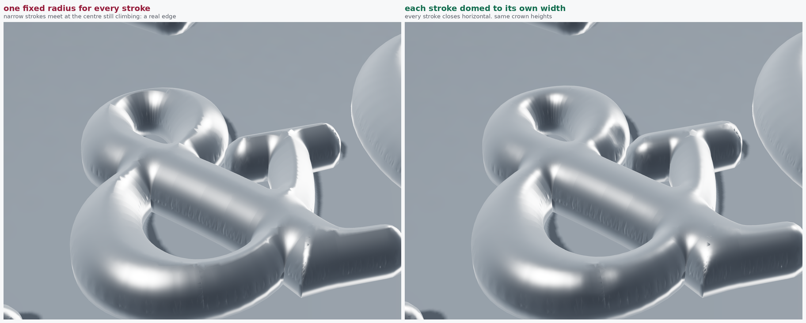

# PA & CO — letters +0.12, diamond +0.50, bar freed, real dome

`paco-50mm-freebar.pdf`, `paco-logo-SMOOTH-v4-dome1.20-base0.45.stl`,
`paco-engineering-sheet.pdf` (2 × A3).
50.25 × 35.96 × 1.65 mm, **seven** pieces, 471.6 mm² in plan.


**The file name changed.** The stepped build and the meshed one were both
written as `paco-logo-freebar-dome1.20-base0.45.stl`, which is how a
superseded file goes on being opened. The real one is now
`paco-logo-SMOOTH-...`; the two are a glance apart in any viewer, at
51,844 triangles against 287,964.


| | |
| --- | --- |
| `paco-dome-before-after.png` | the stacked build against the meshed one |
| `paco-freebar-plan.png` | near plan — the lockup as it reads |
| `paco-freebar-hero.png` | three-quarter |
| `paco-freebar-three.png` | lower three-quarter |
| `paco-freebar-rake.png` | across the light, for the 1.65 mm profile |
| `paco-freebar-detail.png` | the ampersand, close |
| `paco-freebar-diamond.png` | the diamond, close |

Every shot here is lit off the mesh's **own** normals. The earlier satin
set needed `smooth_normals.py` to stand in for a surface the geometry did
not have; this one does not, so what the pictures show is the part.

```sh
python3 scripts/paco_weights.py --letter-grow 0.12 --diamond-scale 1.00 \
        --diamond-grow 0.50 --gap 3.48 --free-bar --out paco-50mm-freebar.pdf
python3 scripts/paco_dome.py --src paco-50mm-freebar.pdf --radius 1.25 \
        --height 1.20 --base 0.45 --smooth --stl paco-logo-freebar-....stl
python3 scripts/paco_sheet.py --src paco-50mm-freebar.pdf \
        --iso paco-iso-freebar.png --height 1.20 --base 0.45
```

## The dome, three goes at it

**It was a staircase.** The top was built by stacking inset outlines —
17 level sets extruded one on the next. The worst tread is the first,
because the profile is vertical where it meets the edge of a stroke: a
**0.42 mm wall** 0.08 mm in from every outline, on a 1.20 mm dome. More
levels do not fix that cheaply; the error sits where the surface is
steepest.


**Then it was a knife edge.** Meshing it properly made the dome smooth
and exposed the real fault, which was in the design and not the mesh.
One radius was being struck from the edge of every stroke, so a stroke
narrower than 2 × 1.25 mm ran out of width before the profile had
flattened and the two faces arrived at the centre still climbing at
about 29°. The surface genuinely had an edge down the middle of every
narrow stroke, and no mesh could remove it. A great deal of work —
graded rims, traced medial axes, ridge constraints — went into
representing that edge faithfully, which was the wrong problem.



**Then each stroke was domed to its own width.** That removed the
crease and introduced a worse fault. Half the local width is not a
smooth quantity — it jumps wherever one branch of the medial axis takes
over from another, and half a millimetre of jump carried into the height
gives surface normals sixty degrees out. Tripling the triangle count
moved it from 26 to 23 degrees: error that does not shrink under
refinement is not in the mesh.

**Now the crease is rounded rather than designed around.** The plain
profile is rastered, blurred with a small mask-normalised kernel, and
blended back over the exact profile with a weight that is zero at the
rim and one well inside. The rim keeps the drawn outline and its
vertical tangent into the wall; the crest, the only place a crease can
form, sits entirely in the blurred part. Slope at the crest, measured
across three strokes: **0.003 to 0.010**, where it was 0.614.

**And the mesh was the other half of it.** Sorting faces by shape said
so plainly: triangles with a minimum angle under ten degrees miss the
true normal by **13 degrees** at the median, against **1.3** for well
shaped ones, and sixteen per cent of the top faces were such slivers.
They were all mine — contours packed along the rim at 0.05 mm spacing
inside bands 0.004 mm wide, chains along the crease. Every seed placed
to control error made it worse. Handed the outline alone, the same
mesher returns a minimum angle of 30 degrees and no slivers at all.

Nothing is placed by hand now: a quality mesh over the whole plan, then
the band within 0.08 mm of the outline taken finer, both bounded.
Neighbouring faces beyond the rim now differ by **2.3 degrees at the
median, 5.1 at p90, 11.8 at p99**. 793,848 triangles, seven closed
bodies, read back from the exported file.

## What the pictures were hiding

Two things, both mine:

The satin finish is a procedural brushed normal map. At the
magnification of a detail shot it is blown up some two hundred times and
reads as surface texture. `paco-finish-vs-mesh.png` is the same mesh
with the maps on and off. Close-ups of geometry now get rendered without
them.

Before that, `smooth_normals.py` was rebuilding the shading off a height
field, which is honest for a picture of a smooth part and was hiding a
staircase. Every render here is lit off the mesh's own normals.

## Two faults found while chasing it

`triangle` is a C library that carries state between calls. Run in
sequence it returned a different triangle count for the same body
depending on what had been triangulated before it, and segfaulted on the
seventh. Each body is now built in its own interpreter — by plain
subprocess, because a multiprocessing Pool deadlocked at zero CPU with
nothing to show.

`medial_axis` thins in a randomised order unless handed a generator.
Left to itself it returned a slightly different skeleton every run,
which moved the measured stroke widths on the drawing as well as the
mesh. All three scripts pass a fixed seed, and two consecutive builds
come out byte for byte identical.

## Measured, not predicted

| | as drawn | built |
| --- | --- | --- |
| letter stroke | 0.98 | **1.26** |
| diamond stroke | 0.98 | **1.63** |
| smallest facet | 2.07 | **1.12** |
| C to O | 1.03 | **0.79** |
| O to its bar | 1.05 | **0.81** |

The bench predicts the diamond at 1.98. It is 1.63. The rule
`stroke = size × 0.98 + 2 × weight` holds to about +0.30 of weight and
then stops: the strokes run out of room to widen while the facets go on
closing. +0.35 buys all but 0.04 mm of the stroke and keeps 0.28 mm more
facet.

The tightest feature in the assembly is no longer in the diamond. It is
the **0.79 mm gap between the C and the O**, a consequence of adding 0.12
to the letters; DETAIL E on sheet 2 draws it.

## The bar

The O arrived tied to its bar by a 1.30 × 1.09 mm stem, all one ring. The
stem is a plain rectangle with its own vertices, so the cut is exact: its
two sides are the highest-reaching vertical edges in the glyph, and the
run of ring between them is the stem and the bar together.

Closing the bowl across the two stem roots with a chord would leave a
1.30 mm flat at the lowest point of a 10 mm O — 0.03 mm shallower than
the curve, so no measurement would find it, but the outline is the
drawing. The bowl is drawn back in from a quadratic through three
vertices either side, corrected linearly to meet the roots exactly rather
than trading a flat for a kink.

The bar is 6.83 × 1.54 mm and **1.56 mm** tall, not 1.65: at 1.54 wide it
runs out of width before the top of the dome and closes into a rounded
rib, which is what the dome does to every stroke narrower than 2.50 mm.
