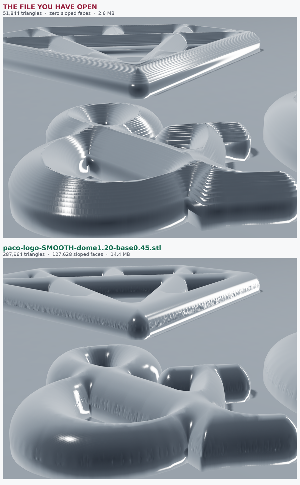
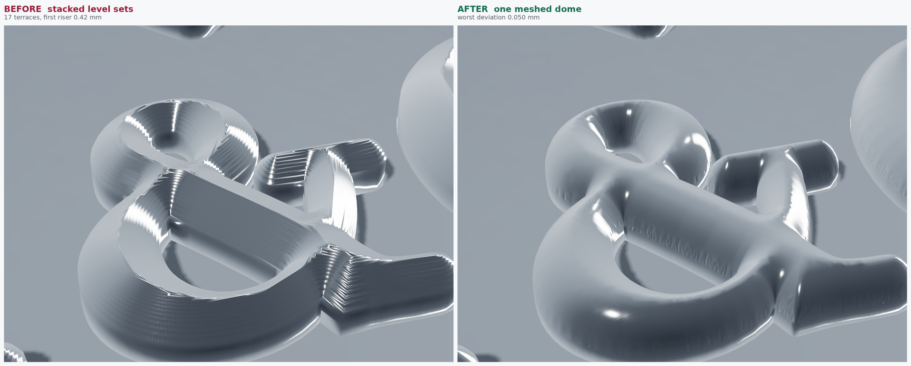

# PA & CO — letters +0.12, diamond +0.50, bar freed, real dome

`paco-50mm-freebar.pdf`, `paco-logo-SMOOTH-dome1.20-base0.45.stl`,
`paco-engineering-sheet.pdf` (2 × A3).
50.25 × 35.96 × 1.65 mm, **seven** pieces, 471.6 mm² in plan.



**The file name changed.** The stepped build and the meshed one were both
written as `paco-logo-freebar-dome1.20-base0.45.stl`, which is how a
superseded file goes on being opened. The real one is now
`paco-logo-SMOOTH-...`; the two are a glance apart in any viewer, at
51,844 triangles against 287,964.



| | |
| --- | --- |
| `paco-dome-before-after.png` | the stacked build against the meshed one |
| `paco-freebar-plan.png` | near plan — the lockup as it reads |
| `paco-freebar-hero.png` | three-quarter |
| `paco-freebar-three.png` | lower three-quarter |
| `paco-freebar-rake.png` | across the light, for the 1.65 mm profile |
| `paco-freebar-detail.png` | the ampersand, close |
| `paco-freebar-diamond.png` | the diamond, close |

Every shot here is lit off the mesh's **own** normals. The earlier satin
set needed `smooth_normals.py` to stand in for a surface the geometry did
not have; this one does not, so what the pictures show is the part.

```sh
python3 scripts/paco_weights.py --letter-grow 0.12 --diamond-scale 1.00 \
        --diamond-grow 0.50 --gap 3.48 --free-bar --out paco-50mm-freebar.pdf
python3 scripts/paco_dome.py --src paco-50mm-freebar.pdf --radius 1.25 \
        --height 1.20 --base 0.45 --smooth --stl paco-logo-freebar-....stl
python3 scripts/paco_sheet.py --src paco-50mm-freebar.pdf \
        --iso paco-iso-freebar.png --height 1.20 --base 0.45
```

## The dome was a staircase

The top surface used to be built by stacking inset outlines — 17 level
sets, extruded one on top of the next. That is a staircase, and the worst
tread is the first, because the profile is **vertical** where it meets the
edge of a stroke:

| step | inset | crown | riser |
| --- | --- | --- | --- |
| 1 | 0.078 | 0.418 | **0.418** |
| 2 | 0.156 | 0.581 | 0.163 |
| 3 | 0.234 | 0.700 | 0.119 |
| … | | | |
| 16 | 1.250 | 1.200 | 0.002 |

A 0.42 mm wall 0.08 mm in from every outline, on a 1.20 mm dome. Adding
levels does not fix it cheaply: the error sits exactly where the surface
is steepest, so halving the tread halves nothing that matters.

`paco_dome.py --smooth` meshes the plan once instead. The outline goes in
as fixed segments — so no serif and no diamond tip is rounded off by a
sampling grid — twelve inset contours seed the rim at equal steps of
*height* rather than of inset, `triangle` fills the rest under a maximum
area rule, and every vertex is lifted to the exact profile at its own
distance from the outline. Outline vertices are at distance zero and stay
where the side wall meets them, so nothing can crack, and the same
triangulation laid flat is the underside.

Measured against the exact profile at every top face: **worst 0.050 mm,
99th percentile 0.031, mean 0.0067** — against a crown tolerance of
±0.10, where the first step of the staircase was four times outside it.
287,964 triangles, seven bodies, all closed, checked by reading the
exported file back rather than the object in memory.

Uniform subdivision was the obvious alternative and is the wrong tool. It
quarters every triangle at once from a mesh whose triangles span the
whole glyph, so a 0.10 mm edge cost 280,000 triangles **for one letter**
— seventeen times what the surface needs — and still left the rim coarse.

## Measured, not predicted

| | as drawn | built |
| --- | --- | --- |
| letter stroke | 0.98 | **1.26** |
| diamond stroke | 0.98 | **1.63** |
| smallest facet | 2.07 | **1.12** |
| C to O | 1.03 | **0.79** |
| O to its bar | 1.05 | **0.81** |

The bench predicts the diamond at 1.98. It is 1.63. The rule
`stroke = size × 0.98 + 2 × weight` holds to about +0.30 of weight and
then stops: the strokes run out of room to widen while the facets go on
closing. +0.35 buys all but 0.04 mm of the stroke and keeps 0.28 mm more
facet.

The tightest feature in the assembly is no longer in the diamond. It is
the **0.79 mm gap between the C and the O**, a consequence of adding 0.12
to the letters; DETAIL E on sheet 2 draws it.

## The bar

The O arrived tied to its bar by a 1.30 × 1.09 mm stem, all one ring. The
stem is a plain rectangle with its own vertices, so the cut is exact: its
two sides are the highest-reaching vertical edges in the glyph, and the
run of ring between them is the stem and the bar together.

Closing the bowl across the two stem roots with a chord would leave a
1.30 mm flat at the lowest point of a 10 mm O — 0.03 mm shallower than
the curve, so no measurement would find it, but the outline is the
drawing. The bowl is drawn back in from a quadratic through three
vertices either side, corrected linearly to meet the roots exactly rather
than trading a flat for a kink.

The bar is 6.83 × 1.54 mm and **1.56 mm** tall, not 1.65: at 1.54 wide it
runs out of width before the top of the dome and closes into a rounded
rib, which is what the dome does to every stroke narrower than 2.50 mm.
