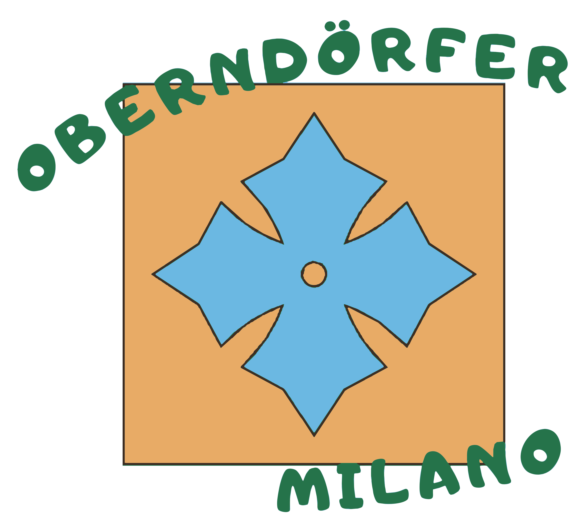

# Oberndörfer Milano — t-shirt logo, vectorised

| File | What it is |
| --- | --- |
| `logo.pdf` / `.svg` | Four flat colours, as vector |
| `logo.png` | 300 dpi render |

Source: `tshirt_design-7.pdf`, whose artwork is an embedded 1147 × 1191 raster.
The page is rendered at **600 dpi** instead of using that raster directly, so
the two vector elements on the page stay crisp; the logo comes out 1628 × 1460.

Pixels are classified to the nearest of the four ink colours plus white, rather
than thresholded per channel — the green and the dark outline are close in
luminance and a per-channel threshold confuses them.

| | colour |
| --- | --- |
| tan | `#e9ac67` |
| blue | `#6cb8e2` |
| green | `#25744a` |
| outline | `#3c2d23` |

Each layer is traced as its own colour **plus everything stacked above it**, so
the shapes overlap rather than abut. Abutting fills leave hairline white seams
at their shared edges when printed or rendered.

97 contours, 3250 segments, 760 × 686 pt.
