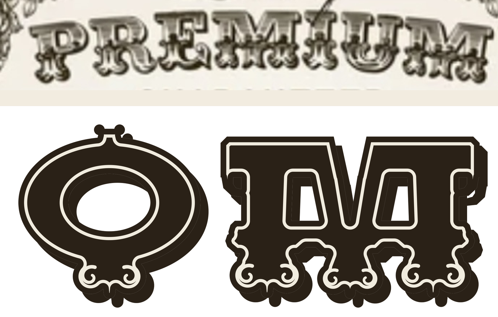

# Tuscan display capitals — O and M

Two capitals matching the "PREMIUM" lettering on the 1936 label: a French
Clarendon / Tuscan circus wood type.



| File | What it is |
| --- | --- |
| `tuscan-O.pdf`, `tuscan-M.pdf` | The letters, ink + inline |
| `tuscan-O-shadow.pdf`, `tuscan-M-shadow.pdf` | The same with the reference's drop shadow |
| `tuscan-OM.pdf`, `tuscan-OM-shadow.pdf` | Both letters on one sheet |
| `reference-premium.png` | The source lettering |
| `trace-attempt.png` | The source M beside a straight trace of it — see below |

Cap height is 480 pt; the geometry is built on a 1000-unit cap height, so it
scales to anything. Ink `#2b2218`, inline `#f2ece0`.

Reproduce with:

```sh
python3 scripts/tuscan_letters.py . --size 480
```

## Measured off the M, not auto-traced — and why

M is in the source word, and every proportion below was measured off it. It is
redrawn rather than auto-traced because at this resolution a trace does not
survive: the scan is 2067 × 375 px, which puts the M at **245 px cap height**,
and the scan's point spread is wide enough to close the letter's counters.
Threshold-and-trace the silhouette and it comes out as a solid slab with
nibbles — `trace-attempt.png` shows the source beside exactly that result.

So the measurements are the copy and the drawing only reopens what the blur
shut. Registering the drawing against the photo at matched cap height gives an
IoU of **0.75** against the thresholded source; most of the remainder is the
counters (correctly open here, blurred shut there) and the two-pixel halo the
threshold adds all round.

### What was measured (cap = 245 px in the scan, expressed in cap units)

| | |
| --- | --- |
| Letter width | 1550 |
| Stem centres | ±497 |
| Stem width | 310 |
| Top slabs | y 755–1000, \|x\| 45–775 |
| Inner strokes | near-vertical, counters a sliver 100–140 wide |
| Ornament band | the three feet merge into one bar at y 330–490 |
| Claws | y 0–490, foot half-width 200, lobes ~165 across on ~230 centres |

## The claws

The clawed foot is the signature of the genre and carries most of the
character. Per foot: the stem flares into a shelf, pulls back to a waist, then
swells into a solid lobed bracket with a pendant drop hanging lowest on the
axis and a lobe either side of it, the bottom edge scalloping into toes.

The lobes are **solid**, and the scrollwork is drawn by the **inline** spiralling
inside each one. That is how the source does it — those light spirals are the
inline, not holes in the letter. An earlier version of this drawing cut them as
holes and the feet came out looking like jewellery rather than wood type.

## Shape notes

The **O** is a heavy ring on the M's weights — the side stroke is the M's stem,
the crown lighter — standing on the same clawed foot, with a short forked spur
at the crown. It has no counterpart in the source word, so it is built entirely
from the M's measurements.

The **M** has upright outer stems, two near-vertical inner strokes closing on a
thin wedge, and three clawed feet joined by one ornamental band, as in the word.

Deliberately not reproduced: the fine horizontal engraving lines filling the
letters. They are an artefact of wood type printed at size; at vector scale they
read as noise. The inline stands in for them.
